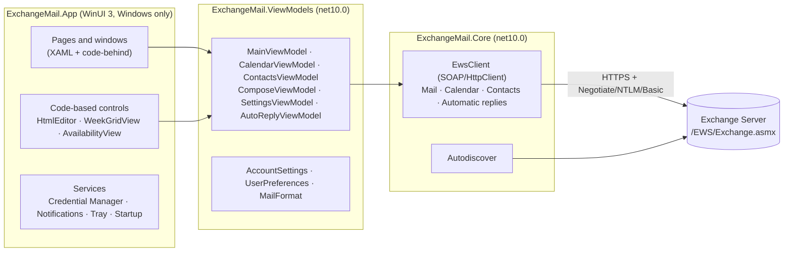

<p align="center">
  
</p>

<h1 align="center">Postacı</h1>

<p align="center">
  A modern Windows mail, calendar and contacts client for on-premises Exchange Server.<br>
  WinUI 3 · .NET 10 · Exchange Web Services
</p>

<p align="center">
  <a href="https://github.com/ordaolmayanadam/postaci/actions/workflows/ci.yml"></a>
  <a href="LICENSE"></a>
  <a href="#built-with-ai"></a>
  <a href="CONTRIBUTING.en.md"></a>
  <a href="https://github.com/ordaolmayanadam/postaci/releases/latest"></a>
</p>

<p align="center">
  <a href="README.md">Türkçe</a> · <b>English</b>
</p>

---

Postacı ("postman" in Turkish) connects to mailboxes hosted on **Exchange Server 2016, 2019 and Subscription
Edition** through **Exchange Web Services (EWS)**. It needs no installation, does not require administrator rights,
and sends data nowhere except the Exchange server you configure.

> [!NOTE]
> **A personal, open-source project built with AI.**
> Postacı is not a company product; it is an independent personal project and open to everyone's contributions.
> Most of the code, tests, documentation and the icon were written by Anthropic's AI assistant **Claude**
> (Claude Code), directed and reviewed by the project owner. See [Built with AI](#built-with-ai) for what has and
> has not been verified.

> [!TIP]
> **The interface is available in English and Turkish.** By default Postacı follows the Windows display language
> (Turkish on Turkish Windows, English otherwise). You can change it under **Settings → Appearance → Language**;
> the new language applies after a restart. Dates and times follow the chosen language too.

## Contents

- [Highlights](#highlights)
- [Installation](#installation)
- [First connection](#first-connection)
- [Features](#features)
- [Keyboard shortcuts](#keyboard-shortcuts)
- [Troubleshooting](#troubleshooting)
- [Building from source](#building-from-source)
- [Continuous integration and releases](#continuous-integration-and-releases)
- [Architecture](#architecture)
- [Data, privacy and security](#data-privacy-and-security)
- [Known limitations and roadmap](#known-limitations-and-roadmap)
- [Built with AI](#built-with-ai)
- [Contributing](#contributing)
- [License](#license)

## Highlights

- **Mail:** instant new mail, conversation view, multi-select and drag-to-folder, server-side search, rich-text
  compose, draft editing, attachments, meeting invitation responses.
- **Calendar:** Outlook-style time grid, drag-and-drop rescheduling, meeting creation with attendee availability.
- **Contacts:** personal contacts and the company directory (Global Address List).
- **Desktop integration:** Windows notifications, system tray, taskbar badge, start with Windows.
- **Safe reading:** scripts disabled in messages, remote images blocked by default.
- **Single sign-on:** password-less connection with your Windows session on domain-joined PCs (Kerberos/NTLM).
- **English and Turkish interface:** follows the Windows display language by default; change it under Settings →
  Appearance → Language. Date and time formats follow the chosen language.

## Installation

### Prebuilt release

1. Download the file matching your processor from the [Releases](https://github.com/ordaolmayanadam/postaci/releases/latest) page:
   - `Postaci-<version>-win-x64.zip`: Intel/AMD PCs
   - `Postaci-<version>-win-arm64.zip`: ARM PCs (e.g. Snapdragon)
2. Optionally verify the download against `SHA256SUMS.txt`:
   ```powershell
   Get-FileHash .\Postaci-1.0.0-win-x64.zip -Algorithm SHA256
   ```
3. Extract the zip to any folder (e.g. `%LOCALAPPDATA%\Programs\Postaci`) and run `Postaci.exe`.

The package is **self-contained**: .NET and the Windows App SDK do not need to be installed separately. The only
required component is the **Microsoft Edge WebView2 Runtime**, which ships with Windows 11; on Windows 10 it can be
installed from [Microsoft's page](https://developer.microsoft.com/microsoft-edge/webview2/) if missing.

> **SmartScreen warning:** releases are not signed with a code-signing certificate, so Windows may show
> "Windows protected your PC" on first launch. Choose **More info → Run anyway**. For corporate deployment we
> recommend signing the package with your organization's certificate.

### System requirements

| | Minimum |
|---|---|
| Operating system | Windows 10 version 1809 (17763) or Windows 11 |
| Architecture | x64 or ARM64 |
| Exchange | Exchange Server 2016, 2019 or Subscription Edition with EWS enabled |

### Uninstalling

1. Quit the app (tray icon → **Exit**).
2. If **Start with Windows** is on in Settings, turn it off.
3. Delete the app folder and the `%LOCALAPPDATA%\Postaci` folder.
4. Optionally remove the saved password: **Control Panel → Credential Manager → Windows Credentials →**
   `Postaci:<user>`. The **Sign out** button in Settings does this too.

## First connection

The connection screen appears on first launch:

| Field | Description |
|---|---|
| **Email address** | Your mailbox address. Autodiscover starts from its domain. |
| **Authentication** | *Use my Windows session (single sign-on)*: no password needed on domain-joined PCs. When off, a user name and password are requested. |
| **User name** | `DOMAIN\user` or `user@company.com`. If left empty, the email address is used. |
| **Save the password in Windows Credential Manager** | The password is stored in Windows Credential Manager and used to connect automatically next time. |
| **Advanced → EWS URL** | Enter it manually if Autodiscover fails: `https://mail.company.com/EWS/Exchange.asmx` |

After you connect, closing the window does not sign you out: the app minimizes to the system tray and keeps checking
for new mail. To quit completely, right-click the tray icon and choose **Exit**.

### Exchange requirements

- The EWS virtual directory must be reachable: `https://<server>/EWS/Exchange.asmx`
- EWS must be enabled for the user and the organization:
  ```powershell
  Get-CASMailbox <user> | Format-List EwsEnabled
  Get-OrganizationConfig | Format-List EwsEnabled
  ```
- The client must trust the server certificate. Domain-joined PCs usually already trust the organization's
  certificate authority. Postacı **never ignores** certificate errors.

## Features

### Mail

- All mail folders are listed hierarchically with unread counts; hidden system folders are not shown.
- The message list loads 50 items at a time. Unread, attachment, high-importance and meeting indicators are shown;
  Sent Items shows the recipient.
- **Search** runs on the server and supports AQS syntax: `from:ali report`, `hasattachment:yes`, `subject:budget`.
- **Instant new mail:** Exchange reports changes right away through a notification subscription (EWS streaming); new
  messages appear at the top of the list within seconds, and read state changed in other clients (Outlook, OWA, phone)
  is synchronized. If the connection drops, Postacı reconnects by itself and meanwhile keeps polling at the interval
  set in Settings (every minute by default).
- **Conversation view:** the button in the list header groups messages by conversation; each row shows the newest
  message's preview and the number of messages. The chevron on conversations with several messages (or the → / ← keys)
  opens and closes the conversation's messages indented under it; each can be opened on its own. Selecting a conversation shows
  all of its messages (including your replies in Sent Items) in the reading pane, newest first, without repeated
  quotes. Reply answers the newest message from someone else in the conversation.
- **Multi-select:** select several messages with Ctrl/Shift-click or Ctrl+A; delete, move and read/unread apply to all
  of them. Messages can be **dragged onto a folder** to move them.
- The selected message is marked **read**; Settings can change this to "after a few seconds" or "never".
  Read receipts requested by senders are never sent silently.
- Reply, reply all, forward, delete (permanent delete with confirmation in Deleted Items), move to folder,
  read/unread.
- **Meeting invitations** can be accepted, tentatively accepted or declined from the reading pane.
- **Person card:** click the sender or a name in To/Cc in the reading pane to see the company directory details (photo,
  job title, department, office, phones), the manager chain from the top down, and direct reports. Clicking a name in
  the chain opens that person's card.
- **Attachments** can be saved; attached emails are downloaded as `.eml`. Inline images in the body are displayed.

### Compose

- **Rich text:** bold, italic, underline, text color and size, bulleted and numbered lists, links.
- **Autocomplete from the company directory** in the To, Cc and Bcc fields.
- Add attachments by picking files or by **drag and drop**.
- **Drafts:** every save from the same window updates the same draft. A message in the Drafts folder opens with
  **Edit draft** or a double-click, and can be edited and sent; attachments on the draft can be removed.
- **The original shows in the editor for replies and forwards:** when the window opens a draft is created, Exchange
  adds the quote (and, for a forward, the attachments), and it is loaded into the editor with its inline images; the
  quote can be edited too. Closing the window without sending removes that automatic draft; a draft kept with
  "Save draft" stays.
- A **rich-text signature** is added automatically to new messages, replies and forwards.
- Closing the window with unsaved changes shows a warning.

### Calendar

- Pick a day from the month calendar. **Day and week views are a time grid** (overlapping events side by side); the
  month view is an agenda list.
- Move events with **drag and drop** (in 15-minute steps, across days). Double-click an empty slot to create an event at that time.
- **New event or meeting:** subject, location, all day, start/end, attendees, reminder, show as (free/tentative/busy/away).
- **Availability:** when creating a meeting, your and the attendees' busy times are shown on a timeline.
- Your own events and meetings you organize can be **edited**; changes are sent to attendees.
- Invitations can be accepted, tentatively accepted or declined; cancelling a meeting you organize notifies attendees.

### Contacts

- Switch between and search **My contacts** (the Contacts folder) and the **Company directory** (the Global
  Address List).
- Details: email, business and mobile phone, job title, department, company. Write an email with one click.
- Add, edit and delete contacts; copy someone from the directory to your contacts.

### Desktop

- **Notifications:** a Windows notification when a new message arrives in the inbox; clicking it opens the message.
- Unread count on the **taskbar badge** and **system tray** icon. Tray menu: Open, New mail, Check for new mail, Exit.
- **Start with Windows** (optional): starts in the tray and connects with the saved account. No admin rights needed.
- **Automatic replies (Out of Office):** date range, separate messages for internal and external senders. A banner is shown at the top while they are on.

### Settings

| Section | Options |
|---|---|
| **Mail** | When to mark as read, new-mail check interval, always show remote images, signature, notifications |
| **Automatic replies** | On/off, time range, internal and external reply text, external audience |
| **Application** | Minimize to tray on close, start with Windows |
| **Appearance** | Theme (Windows / light / dark; the dark theme uses soft slate-blue tones), language (Windows / Türkçe / English, applied after restart), folder list (compact / comfortable) |
| **Fonts** | Interface font and size (applied after restart), reading font and zoom, compose font and size |
| **Account** | Email, server, sign-in method; delete saved password, sign out |

## Keyboard shortcuts

| Shortcut | Action |
|---|---|
| `Ctrl+1` / `Ctrl+2` / `Ctrl+3` | Mail / Calendar / Contacts |
| `Ctrl+N` | New mail (new event in Calendar, new contact in Contacts) |
| `Ctrl+R` / `Ctrl+Shift+R` | Reply / Reply all |
| `Ctrl+F` | Forward |
| `Del` | Delete (when the message list has focus) |
| `Ctrl+Q` | Toggle read / unread (all selected messages) |
| `Ctrl+A` | Select all in the message list |
| `Ctrl+E` | Search |
| `F5` | Refresh |
| `F9` | Send/Receive: check for new mail now |
| `Ctrl+Enter` / `Ctrl+S` | Send / Save draft (in the compose window) |
| `Ctrl+B` / `Ctrl+I` / `Ctrl+U` | Bold / Italic / Underline (in the compose window) |
| `Ctrl` + mouse wheel | Zoom the reading pane |

## Troubleshooting

| Symptom | Likely cause and fix |
|---|---|
| "Autodiscover could not find the EWS URL" | No Autodiscover DNS record, or it is not reachable. Enter the URL manually under **Advanced → EWS URL**. |
| "Authentication failed" | Try the other user name format (`DOMAIN\user` ↔ UPN). If Windows session sign-in is selected, make sure the PC is domain-joined. |
| "Could not reach the server" / certificate error | The server certificate is not trusted on this PC, or there is no network access. Open the EWS URL in a browser and check the certificate. |
| `ErrorServerBusy` | Exchange throttling limit reached. Postacı automatically waits and retries; if it persists, increase the check interval. |
| Empty message body / "Could not start WebView2" | WebView2 Runtime is missing. Install it [from Microsoft](https://developer.microsoft.com/microsoft-edge/webview2/). |
| No notifications | Check that Postacı is allowed under Windows Settings → Notifications and that Do Not Disturb is off. Notifications must also be enabled in Postacı's Settings. |
| Password requested on every launch | **Save the password in Windows Credential Manager** must be checked when connecting. Check that a `Postaci:<user>` entry exists in Credential Manager. |
| Calendar times are shifted | Check the Windows time zone; Postacı sends the Windows time zone to Exchange with calendar requests. |

When reporting a bug, please use the [bug template](.github/ISSUE_TEMPLATE/bug_report.yml) and **do not share real
mail content, addresses or server names**. Issues may be written in English or Turkish.

## Building from source

### Requirements

- **For the full app:** Windows 10/11 and the [.NET 10 SDK](https://dotnet.microsoft.com/download/dotnet/10.0).
  Optionally Visual Studio 2026 (or 2022 17.14+) with the **WinUI application development** workload.
- **For the libraries and tests only:** the .NET 10 SDK is enough; it works on Linux and macOS too.

### Commands

```powershell
# Build and run the app
dotnet build src\ExchangeMail.App -c Debug -p:Platform=x64
.\src\ExchangeMail.App\bin\x64\Debug\net10.0-windows10.0.19041.0\win-x64\Postaci.exe

# Distributable folder (no installer, self-contained)
dotnet publish src\ExchangeMail.App -c Release -r win-x64 --self-contained -p:Platform=x64 -o publish\win-x64

# For ARM64
dotnet publish src\ExchangeMail.App -c Release -r win-arm64 --self-contained -p:Platform=ARM64 -o publish\win-arm64

# Tests (any operating system)
dotnet test --project tests\ExchangeMail.Core.Tests
```

In Visual Studio, open `ExchangeMail.slnx`, set **ExchangeMail.App** as the startup project, select the **x64**
platform and press F5.

> Do not build the whole solution (e.g. by running `dotnet test` at the root) on Linux/macOS: the WinUI project's
> XAML compiler only runs on Windows. Run the test project with `--project`.

## Continuous integration and releases

| Workflow | When | What it does |
|---|---|---|
| [`ci.yml`](.github/workflows/ci.yml) | Every push to `main`, every pull request, manually | Runs the tests on Ubuntu and Windows, then publishes the app for x64 and ARM64 and keeps them as `Postaci-win-x64` / `Postaci-win-arm64` artifacts for 14 days |
| [`release.yml`](.github/workflows/release.yml) | When a tag like `v1.2.3` is pushed | Runs the tests, builds zips for both architectures using the version from the tag, computes `SHA256SUMS.txt` and creates a GitHub release |
| [`dependabot.yml`](.github/dependabot.yml) | Weekly | Opens update PRs for NuGet packages and GitHub Actions |

**To publish a new release:**

```bash
git tag v1.0.0
git push origin v1.0.0
```

If the tag contains `-` (e.g. `v1.1.0-beta.1`) the release is marked as a pre-release. Release notes are generated
automatically from the PRs merged since the previous tag.

## Architecture



| Project | Target | Responsibility |
|---|---|---|
| `src/ExchangeMail.Core` | `net10.0` | EWS client (raw SOAP over `HttpClient`), Autodiscover, models, Turkish/English text resources. Knows nothing about the UI. |
| `src/ExchangeMail.ViewModels` | `net10.0` | MVVM layer ([CommunityToolkit.Mvvm](https://learn.microsoft.com/dotnet/communitytoolkit/mvvm/)), preferences, HTML helpers. No WinUI dependency. |
| `src/ExchangeMail.App` | `net10.0-windows` | WinUI 3 UI, WebView2, Windows services. Unpackaged (`WindowsPackageType=None`) and self-contained. |
| `tests/ExchangeMail.Core.Tests` | `net10.0` | Unit tests (xUnit v3) against a fake EWS server (`FakeEwsServer`). They also verify the structure and order of the SOAP requests sent. |

All business logic lives in two libraries that do not depend on Windows, so CI builds and tests them on Linux.
The EWS Managed API is not used; Microsoft no longer develops it.

### Key flows

**Sending.** A new message without attachments is sent with a single `CreateItem(SendAndSaveCopy)`. Replies,
forwards, messages with attachments and existing drafts are sent in this order:

1. `GetItem`: fetch the current `ChangeKey` of the original message.
2. `CreateItem(SaveOnly)` + `ReplyToItem` / `ReplyAllToItem` / `ForwardItem`: Exchange creates the draft with the quote.
   For replies and forwards this happens when the compose window opens; the draft's body (`GetItem`, and
   `GetAttachment` for inline images) is loaded into the editor. Images become `data:` URLs in the editor and are turned
   back into `cid:` references when saving; the original's `<head>` styles are kept.
3. `UpdateItem`: write the recipients, subject, importance and (once a draft exists) body edited by the user.
4. `CreateAttachment` / `DeleteAttachment`: add or remove attachments.
5. `SendItem`: send the draft and save it to Sent Items.

**New mail.** After sign-in, an EWS streaming subscription (`Subscribe` + `GetStreamingEvents`) covering every folder
is opened; the server keeps the connection open and pushes each change immediately. When a change concerns mail folders,
the folder counts and the visible list are refreshed right away. The connection is renewed every 10 minutes; a lost
subscription is recreated, and when the server is unreachable it retries at intervals growing from 15 seconds to 5
minutes. As a fallback, polling continues at the interval set in Settings; a notification is shown for unread messages
not seen before. Requests carry an `X-AnchorMailbox` header so multi-server deployments route them to the mailbox's
server.

**Conversations.** In conversation view the list comes from `FindConversation` and the selected conversation's messages
from `GetConversationItems` (excluding Deleted Items and Drafts). Each message shows only the text it added
(`UniqueBody`). Search results and Drafts / Outbox are always listed as individual messages.

**Calendar.** Calendar requests include the Windows time zone (`TimeZoneContext`), so all-day events and views are
computed in local time. Recurring meetings are expanded into individual occurrences with `CalendarView`.

**Server load.** When Exchange returns `ErrorServerBusy`, the client waits for the back-off time reported by the
server (at most 30 s) and retries up to twice.

## Data, privacy and security

| What | Where |
|---|---|
| Account settings (email, user name, EWS URL) | `%LOCALAPPDATA%\Postaci\settings.json` |
| Preferences | `%LOCALAPPDATA%\Postaci\preferences.json` |
| Password | Windows Credential Manager → Generic: `Postaci:<user>` |
| WebView2 profile | `%LOCALAPPDATA%\Postaci\WebView2` |
| Reading pane temporary files | `%TEMP%\Postaci` (cleared on every launch) |
| Start with Windows | `HKCU\Software\Microsoft\Windows\CurrentVersion\Run\Postaci` |

- The password is never written to disk in plain text; it is kept only in Credential Manager (protected with DPAPI).
- Message bodies are displayed with a **Content-Security-Policy** that blocks scripts and (unless allowed) remote
  resources; scripts are disabled in WebView2 and Exchange's `FilterHtmlContent` filter is on. Links open in the default browser.
- TLS certificate validation is never disabled.
- **No telemetry.** The app's only network traffic goes to the configured Exchange server.

See the [security policy](SECURITY.en.md) for reporting vulnerabilities.

## Known limitations and roadmap

- No Tasks.
- Editing an entire recurring series is not supported; changes made in the grid affect only that occurrence.
- Event duration cannot be changed by dragging an edge in the grid; change it in the edit dialog.
- In conversation view only the newest message's inline images are loaded; open an older message on its own to see its images.
- No pasting/inserting images or table editing in the compose window.
- No Hybrid Modern Authentication (OAuth); only Negotiate (Kerberos/NTLM) and Basic.
- No S/MIME encryption/signing, shared mailboxes or archive mailbox.
- Changing the interface font requires a restart; some built-in WinUI parts may keep their own size.

Suggestions are welcome as a [feature request](.github/ISSUE_TEMPLATE/feature_request.yml).

## Built with AI

Postacı is a project developed by one person together with an AI assistant, and we want to be upfront about it:

- **How was it written?** The project owner described the features and reported bugs from a user's point of view;
  the code, tests, CI workflows, documentation and icon were largely produced by **Claude (Anthropic)** using Claude
  Code. Commits made with AI assistance carry a `Co-Authored-By: Claude …` trailer, so `git log` shows which
  changes were made this way.
- **What has been verified?** All code that talks to Exchange, and the ViewModel behaviour, is covered by automated
  tests running against a fake EWS server. The tests and the Windows build of the app run on GitHub Actions for
  every change.
- **What has not been verified yet?** Not every feature has been tried against a real Exchange server or on
  different Windows versions, and the code has not had an independent security audit. AI-generated code can contain
  bugs just like human-written code.
- **What do we recommend?** Talk to your IT department before connecting Postacı to a work mailbox, try important
  actions (deleting, sending, automatic replies) on a test account first, and report every bug you find as an
  [issue](../../issues).

Contributions prepared with AI tools are welcome too; the rules are in
[CONTRIBUTING.en.md](CONTRIBUTING.en.md#contributing-with-ai-tools).

## Contributing

Postacı is open to everyone: whether this is your first open-source contribution or you are an experienced
developer, bug reports, suggestions, documentation fixes, translations, tests and code are all welcome. Even trying
it on a real Exchange server and sharing the result is very valuable.

The [contributor guide](CONTRIBUTING.en.md) covers the development environment, layering rules, how to add an EWS
operation, writing tests and the PR process. Issues, PRs and commit messages may be written in English or Turkish.
How we treat each other is described in the [Code of Conduct](CODE_OF_CONDUCT.en.md).

## License

Postacı is distributed under the [MIT License](LICENSE): you may freely use, modify and distribute the code,
including in commercial projects; the only condition is to keep the copyright and license notice with copies. The
software is provided "as is", without warranty of any kind.

The main components used are open source as well: .NET and the Windows App SDK (MIT), CommunityToolkit.Mvvm (MIT),
xUnit (Apache 2.0). The Microsoft Edge WebView2 Runtime ships with the operating system and is not redistributed
with the app.

Microsoft, Exchange, Outlook and Windows are trademarks of Microsoft Corporation. Postacı is an independent project
and is not affiliated with, sponsored or endorsed by Microsoft.

Icon sources and the scripts that regenerate them are in [`assets/icon/`](assets/icon/).
