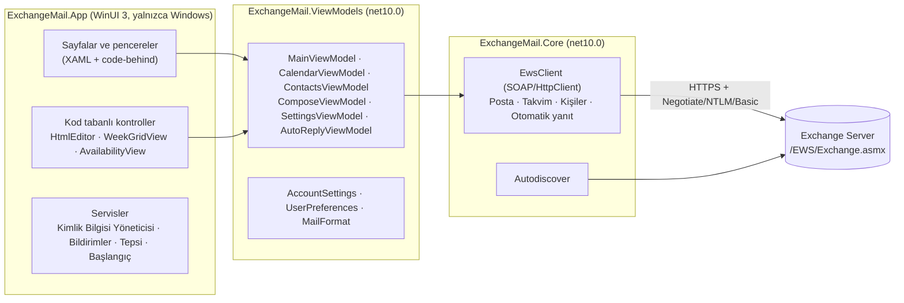

<p align="center">
  
</p>

<h1 align="center">Postacı</h1>

<p align="center">
  Şirket içi (on-premises) Exchange Server için modern bir Windows posta, takvim ve kişiler istemcisi.<br>
  WinUI 3 · .NET 10 · Exchange Web Services
</p>

<p align="center">
  <a href="https://github.com/KULLANICI/DEPO/actions/workflows/ci.yml"></a>
  <a href="https://github.com/KULLANICI/DEPO/releases/latest"></a>
</p>

---

Postacı, kurum içinde barındırılan **Exchange Server 2016, 2019 ve Subscription Edition** posta kutularına
**Exchange Web Services (EWS)** üzerinden bağlanır. Kurulum gerektirmez, yönetici yetkisi istemez ve
yapılandırılan Exchange sunucusu dışında hiçbir yere veri göndermez.

## İçindekiler

- [Öne çıkanlar](#öne-çıkanlar)
- [Kurulum](#kurulum)
- [İlk bağlantı](#ilk-bağlantı)
- [Özellikler](#özellikler)
- [Klavye kısayolları](#klavye-kısayolları)
- [Sorun giderme](#sorun-giderme)
- [Kaynak koddan derleme](#kaynak-koddan-derleme)
- [Sürekli entegrasyon ve sürüm yayınlama](#sürekli-entegrasyon-ve-sürüm-yayınlama)
- [Mimari](#mimari)
- [Veriler, gizlilik ve güvenlik](#veriler-gizlilik-ve-güvenlik)
- [Bilinen sınırlamalar ve yol haritası](#bilinen-sınırlamalar-ve-yol-haritası)
- [Katkıda bulunma](#katkıda-bulunma)
- [Lisans](#lisans)

## Öne çıkanlar

- **Posta:** klasör ağacı, sunucu taraflı arama, biçimli yazma, taslak düzenleme, ekler, toplantı davetlerine yanıt.
- **Takvim:** Outlook tarzı saat ızgarası, sürükle-bırak ile taşıma, toplantı oluşturma ve katılımcı uygunluğu.
- **Kişiler:** kişisel kişiler ve şirket rehberi (genel adres listesi).
- **Masaüstüne uyum:** Windows bildirimleri, sistem tepsisi, görev çubuğu rozeti, Windows açılışında başlatma.
- **Güvenli okuma:** iletilerde betikler kapalı, uzak resimler varsayılan olarak engelli.
- **Tek oturum açma:** etki alanındaki bilgisayarlarda Windows oturumuyla parolasız bağlantı (Kerberos/NTLM).

## Kurulum

### Hazır sürüm

1. [Sürümler (Releases)](https://github.com/KULLANICI/DEPO/releases/latest) sayfasından işlemcinize uygun dosyayı indirin:
   - `Postaci-<sürüm>-win-x64.zip`: Intel/AMD işlemcili bilgisayarlar
   - `Postaci-<sürüm>-win-arm64.zip`: ARM işlemcili bilgisayarlar (ör. Snapdragon)
2. İsterseniz dosyanın bütünlüğünü `SHA256SUMS.txt` ile doğrulayın:
   ```powershell
   Get-FileHash .\Postaci-1.0.0-win-x64.zip -Algorithm SHA256
   ```
3. Zip'i istediğiniz bir klasöre açın (ör. `%LOCALAPPDATA%\Programs\Postaci`) ve `Postaci.exe`'yi çalıştırın.

Paket **kendi içinde bütündür** (self-contained): .NET veya Windows App SDK ayrıca kurulmaz. Gereken tek bileşen
Windows 11'de hazır gelen **Microsoft Edge WebView2 Runtime**'dır; Windows 10'da eksikse
[Microsoft'un sayfasından](https://developer.microsoft.com/microsoft-edge/webview2/) kurulabilir.

> **SmartScreen uyarısı:** Sürümler kod imzalama sertifikasıyla imzalanmadığı için Windows ilk çalıştırmada
> "Windows bilgisayarınızı korudu" uyarısı gösterebilir. **Ek bilgi → Yine de çalıştır** ile açılır.
> Kurumsal dağıtımda paketi kurum sertifikasıyla imzalamanız önerilir.

### Sistem gereksinimleri

| | En az |
|---|---|
| İşletim sistemi | Windows 10 sürüm 1809 (17763) veya Windows 11 |
| Mimari | x64 veya ARM64 |
| Exchange | Exchange Server 2016, 2019 veya Subscription Edition; EWS açık |

### Kaldırma

1. Uygulamayı kapatın (tepsi simgesi → **Çıkış**).
2. Ayarlar'da **Windows açılışında başlat** açıksa kapatın.
3. Uygulama klasörünü ve `%LOCALAPPDATA%\Postaci` klasörünü silin.
4. İsterseniz kayıtlı parolayı silin: **Denetim Masası → Kimlik Bilgisi Yöneticisi → Windows Kimlik Bilgileri →**
   `Postaci:<kullanıcı>`. Ayarlar'daki **Oturumu kapat** düğmesi de bunu yapar.

## İlk bağlantı

İlk açılışta bağlantı ekranı gelir:

| Alan | Açıklama |
|---|---|
| **E-posta adresi** | Posta kutunuzun adresi. Autodiscover bu adresin alan adından yola çıkar. |
| **Kimlik doğrulama** | *Windows oturumumu kullan*: etki alanındaki bilgisayarlarda parola gerekmez. Kapalıysa kullanıcı adı ve parola istenir. |
| **Kullanıcı adı** | `ŞİRKET\kullanici` ya da `kullanici@sirket.com.tr`. Boş bırakılırsa e-posta adresi kullanılır. |
| **Parolayı sakla** | Parola Windows Kimlik Bilgisi Yöneticisi'nde saklanır; sonraki açılışlarda otomatik bağlanılır. |
| **Gelişmiş → EWS adresi** | Autodiscover çalışmazsa elle girin: `https://mail.sirket.com.tr/EWS/Exchange.asmx` |

Bağlandıktan sonra pencereyi kapatmak oturumu kapatmaz: uygulama sistem tepsisine küçülür ve yeni postaları
denetlemeye devam eder. Tamamen kapatmak için tepsi simgesine sağ tıklayıp **Çıkış**'ı seçin.

### Exchange tarafında gerekenler

- EWS sanal dizini erişilebilir olmalı: `https://<sunucu>/EWS/Exchange.asmx`
- EWS kullanıcı ve kuruluş için açık olmalı:
  ```powershell
  Get-CASMailbox <kullanıcı> | Format-List EwsEnabled
  Get-OrganizationConfig | Format-List EwsEnabled
  ```
- Sunucu sertifikası istemcide güvenilir olmalı. Etki alanındaki bilgisayarlar kurum sertifika yetkilisine
  genellikle zaten güvenir. Postacı sertifika hatalarını **yok saymaz**.

## Özellikler

### Posta

- Bütün posta klasörleri hiyerarşik ve okunmamış sayılarıyla listelenir; gizli sistem klasörleri gösterilmez.
- İleti listesi 50'şer öğe yüklenir. Okunmamış, ek, yüksek önem ve toplantı işaretleri görünür; Gönderilmiş Öğeler'de alıcı gösterilir.
- **Arama** sunucu tarafında yapılır ve AQS sözdizimini destekler: `from:ali rapor`, `hasattachment:yes`, `subject:bütçe`.
- **Arka planda yenileme** (varsayılan dakikada bir): yeni iletiler listenin başına eklenir, başka istemcilerde
  (Outlook, OWA, telefon) değişen okundu durumu eşitlenir.
- Seçilen ileti **okundu** sayılır; Ayarlar'dan "birkaç saniye sonra" veya "hiçbir zaman" seçilebilir.
  Okundu bilgisi istenmiş iletiler için bildirim sessizce gönderilmez.
- Yanıtla, tümünü yanıtla, ilet, sil (Silinmiş Öğeler'de onayla kalıcı silme), klasöre taşı, okundu/okunmadı.
- **Toplantı davetleri** okuma bölmesinden kabul edilir, "belki" yanıtı verilir veya reddedilir.
- **Ekler** kaydedilir; ekli e-postalar `.eml` olarak indirilir. Gövdedeki gömülü resimler gösterilir.

### Yazma

- **Biçimli metin:** kalın, italik, altı çizili, yazı rengi ve boyutu, madde işaretli ve numaralı liste, bağlantı.
- Kime, Bilgi ve Gizli alanlarında **şirket rehberinden otomatik tamamlama**.
- Dosya seçerek veya **sürükle-bırak** ile ek ekleme.
- **Taslaklar:** aynı penceredeki her kayıt aynı taslağı günceller. Taslaklar klasöründeki ileti
  *Taslağı düzenle* (veya çift tıklama) ile açılır, düzenlenir ve gönderilir; taslaktaki ekler kaldırılabilir.
- Yanıt ve iletmelerde özgün ileti Exchange tarafından alta eklenir; kaydedilen yanıt taslağında alıntı düzenleyicide görünür.
- **Biçimli imza** yeni iletilere, yanıtlara ve iletmelere otomatik eklenir.
- Kaydedilmemiş değişiklik varken pencere kapatılırsa uyarı gösterilir.

### Takvim

- Ay takviminden gün seçilir. **Gün ve hafta görünümü saat ızgarasıdır** (çakışan etkinlikler yan yana); ay görünümü ajanda listesidir.
- Etkinlikler **sürükle-bırak** ile taşınır (15 dakikalık adımlarla, günler arasında). Boş bir saate çift tıklamak o saatte yeni etkinlik açar.
- **Yeni etkinlik veya toplantı:** konu, konum, tüm gün, başlangıç/bitiş, katılımcılar, anımsatıcı, durum (boş/belki/meşgul/dışarıda).
- **Uygunluk:** toplantı oluştururken sizin ve katılımcıların meşgul saatleri zaman çizelgesinde görünür.
- Kendi etkinlikleriniz ve düzenleyeni olduğunuz toplantılar **düzenlenir**; değişiklik katılımcılara bildirilir.
- Davetler kabul edilir, "belki" yanıtı verilir veya reddedilir; düzenlediğiniz toplantı iptal edilince katılımcılara bildirim gider.

### Kişiler

- **Kişilerim** (Kişiler klasörü) ve **Şirket rehberi** (genel adres listesi) arasında geçiş ve arama.
- Ayrıntı: e-posta, iş ve cep telefonu, unvan, departman, şirket. Tek tıkla e-posta yazma.
- Kişi ekleme, düzenleme, silme; rehberdeki birini kişilerinize kopyalama.

### Masaüstü

- **Bildirimler:** gelen kutusuna yeni ileti düştüğünde Windows bildirimi; tıklayınca ileti açılır.
- **Görev çubuğu rozeti** ve **sistem tepsisi** simgesinde okunmamış sayısı. Tepsi menüsü: Aç, Yeni posta, Yeni postaları denetle, Çıkış.
- **Windows açılışında başlatma** (isteğe bağlı): tepside başlar, kayıtlı hesapla bağlanır. Yönetici yetkisi gerekmez.
- **Otomatik yanıtlar (ofis dışında):** tarih aralığı, kuruluş içi ve dışı için ayrı metin. Açıkken üstte uyarı şeridi görünür.

### Ayarlar

| Bölüm | Seçenekler |
|---|---|
| Posta | Okundu işaretleme zamanı, yeni posta denetim aralığı, uzak resimleri her zaman gösterme, imza, bildirimler |
| Otomatik yanıtlar | Açık/kapalı, zaman aralığı, iç ve dış yanıt metinleri, dış alıcı kapsamı |
| Uygulama | Kapatınca tepsiye küçült, Windows açılışında başlat |
| Görünüm | Tema (Windows / açık / koyu) |
| Yazı tipleri | Arayüz yazı tipi ve boyutu (yeniden başlatınca uygulanır), okuma yazı tipi ve yakınlaştırma, yazma yazı tipi ve boyutu |
| Hesap | E-posta, sunucu, oturum açma yöntemi; kayıtlı parolayı silme, oturumu kapatma |

## Klavye kısayolları

| Kısayol | İşlem |
|---|---|
| `Ctrl+1` / `Ctrl+2` / `Ctrl+3` | Posta / Takvim / Kişiler |
| `Ctrl+N` | Yeni posta (Takvim'de yeni etkinlik, Kişiler'de yeni kişi) |
| `Ctrl+R` / `Ctrl+Shift+R` | Yanıtla / Tümünü yanıtla |
| `Ctrl+F` | İlet |
| `Del` | Sil (ileti listesindeyken) |
| `Ctrl+Q` | Okundu / okunmadı |
| `Ctrl+E` | Ara |
| `F5` | Yenile |
| `Ctrl+Enter` / `Ctrl+S` | Gönder / Taslak kaydet (yazma penceresinde) |
| `Ctrl+B` / `Ctrl+I` / `Ctrl+U` | Kalın / İtalik / Altı çizili (yazma penceresinde) |
| `Ctrl` + fare tekerleği | Okuma bölmesinde yakınlaştırma |

## Sorun giderme

| Belirti | Olası neden ve çözüm |
|---|---|
| "Autodiscover EWS adresini bulamadı" | Autodiscover DNS kaydı yok veya dışarıya kapalı. **Gelişmiş → EWS adresi** alanına adresi elle girin. |
| "Kimlik doğrulama başarısız" | Kullanıcı adı biçimini deneyin (`ŞİRKET\kullanici` ↔ UPN). Windows oturumu seçiliyse bilgisayarın etki alanında olduğundan emin olun. |
| "Sunucuya ulaşılamadı" / sertifika hatası | Sunucu sertifikası bu bilgisayarda güvenilir değil veya ağ erişimi yok. Tarayıcıda EWS adresini açıp sertifikayı kontrol edin. |
| `ErrorServerBusy` | Exchange istek sınırına (throttling) ulaşıldı. Postacı otomatik olarak bekleyip yeniden dener; sürerse denetim aralığını uzatın. |
| İleti gövdesi boş / "WebView2 başlatılamadı" | WebView2 Runtime eksik. [Microsoft'tan](https://developer.microsoft.com/microsoft-edge/webview2/) kurun. |
| Bildirim çıkmıyor | Windows Ayarlar → Bildirimler'de Postacı'nın açık olduğunu ve "Rahatsız etmeyin"in kapalı olduğunu kontrol edin. Postacı Ayarlar'ında bildirimler açık olmalı. |
| Her açılışta parola soruluyor | Bağlanırken "Parolayı sakla" işaretli olmalı. Kimlik Bilgisi Yöneticisi'nde `Postaci:<kullanıcı>` kaydının oluştuğunu kontrol edin. |
| Takvim saatleri kayık | Windows saat dilimi ayarını kontrol edin; Postacı takvim isteklerinde Windows saat dilimini Exchange'e bildirir. |

Hata bildirirken lütfen [hata şablonunu](.github/ISSUE_TEMPLATE/bug_report.yml) kullanın ve **gerçek posta içeriği,
adres veya sunucu adı paylaşmayın**.

## Kaynak koddan derleme

### Gereksinimler

- **Uygulamanın tamamı için:** Windows 10/11, [.NET 10 SDK](https://dotnet.microsoft.com/download/dotnet/10.0).
  İsteğe bağlı olarak Visual Studio 2026 (veya 2022 17.14+) ve **WinUI application development** iş yükü.
- **Yalnızca kütüphaneler ve testler için:** .NET 10 SDK yeterlidir; Linux ve macOS'ta da çalışır.

### Komutlar

```powershell
# Uygulamayı derleyip çalıştırma
dotnet build src\ExchangeMail.App -c Debug -p:Platform=x64
.\src\ExchangeMail.App\bin\x64\Debug\net10.0-windows10.0.19041.0\win-x64\Postaci.exe

# Dağıtılabilir klasör (kurulumsuz, self-contained)
dotnet publish src\ExchangeMail.App -c Release -r win-x64 --self-contained -p:Platform=x64 -o publish\win-x64

# ARM64 için
dotnet publish src\ExchangeMail.App -c Release -r win-arm64 --self-contained -p:Platform=ARM64 -o publish\win-arm64

# Testler (her işletim sisteminde)
dotnet test --project tests\ExchangeMail.Core.Tests
```

Visual Studio'da `ExchangeMail.slnx` dosyasını açın, **ExchangeMail.App**'i başlangıç projesi yapın, platformu
**x64** seçip F5'e basın.

> Çözümün tamamını (`dotnet test` köke çalıştırarak) Linux/macOS'ta derlemeye çalışmayın: WinUI projesinin XAML
> derleyicisi yalnızca Windows'ta çalışır. Test projesini `--project` ile çalıştırın.

## Sürekli entegrasyon ve sürüm yayınlama

| İş akışı | Ne zaman | Ne yapar |
|---|---|---|
| [`ci.yml`](.github/workflows/ci.yml) | `main`'e her push, her pull request, elle | Testleri Ubuntu ve Windows'ta çalıştırır; ardından uygulamayı x64 ve ARM64 için yayımlar ve `Postaci-win-x64` / `Postaci-win-arm64` artifact'leri olarak 14 gün saklar |
| [`release.yml`](.github/workflows/release.yml) | `v1.2.3` biçiminde etiket push edildiğinde | Testleri çalıştırır, etiketteki sürüm numarasıyla iki mimari için zip üretir, `SHA256SUMS.txt` hesaplar ve GitHub sürümü oluşturur |
| [`dependabot.yml`](.github/dependabot.yml) | Haftalık | NuGet paketleri ve GitHub Actions için güncelleme PR'ları açar |

**Yeni sürüm yayınlamak için:**

```bash
git tag v1.0.0
git push origin v1.0.0
```

Etiket `-` içeriyorsa (ör. `v1.1.0-beta.1`) sürüm "ön sürüm" olarak işaretlenir. Sürüm notları, önceki etiketten
bu yana birleştirilen PR'lardan otomatik oluşturulur.

## Mimari



| Proje | Hedef | Sorumluluk |
|---|---|---|
| `src/ExchangeMail.Core` | `net10.0` | EWS istemcisi (ham SOAP, `HttpClient`), Autodiscover, modeller. Arayüzden habersiz. |
| `src/ExchangeMail.ViewModels` | `net10.0` | MVVM katmanı ([CommunityToolkit.Mvvm](https://learn.microsoft.com/dotnet/communitytoolkit/mvvm/)), tercihler, HTML yardımcıları. WinUI'ye bağımlı değil. |
| `src/ExchangeMail.App` | `net10.0-windows` | WinUI 3 arayüzü, WebView2, Windows servisleri. Paketsiz (`WindowsPackageType=None`) ve self-contained. |
| `tests/ExchangeMail.Core.Tests` | `net10.0` | Sahte EWS sunucusuna (`FakeEwsServer`) karşı birim testleri (xUnit v3). Gönderilen SOAP isteklerinin yapısını ve sırasını da doğrular. |

İş mantığının tamamı Windows'a bağımlı olmayan iki kütüphanede durduğu için CI'da Linux'ta derlenip test edilir.
EWS Managed API kullanılmaz; Microsoft o kütüphaneyi artık geliştirmiyor.

### Önemli akışlar

**Gönderme.** Eki olmayan yeni ileti tek bir `CreateItem(SendAndSaveCopy)` ile gider. Yanıt, iletme, ekli ileti
veya var olan taslak şu sırayla gönderilir:

1. `GetItem`: özgün iletinin güncel `ChangeKey`'i alınır.
2. `CreateItem(SaveOnly)` + `ReplyToItem` / `ReplyAllToItem` / `ForwardItem`: Exchange alıntıyı ekleyerek taslağı oluşturur.
3. `UpdateItem`: kullanıcının düzenlediği alıcılar, konu ve önem yazılır.
4. `CreateAttachment` / `DeleteAttachment`: ekler eklenir veya kaldırılır.
5. `SendItem`: taslak gönderilir ve Gönderilmiş Öğeler'e kaydedilir.

**Yeni posta.** Ayarlardaki aralıkla klasör sayıları ve gelen kutusunun ilk sayfası yoklanır; daha önce görülmemiş
okunmamış iletiler için bildirim gösterilir. EWS bildirim aboneliği (streaming) henüz kullanılmıyor.

**Takvim.** Takvim isteklerine Windows saat dilimi (`TimeZoneContext`) eklenir. Böylece tüm gün etkinlikleri ve
görünümler yerel saate göre hesaplanır. Yinelenen toplantılar `CalendarView` ile tek tek tekrarlara açılır.

**Sunucu yükü.** Exchange `ErrorServerBusy` döndürdüğünde istemci, sunucunun bildirdiği süre kadar (en fazla 30 sn)
bekleyip iki kez yeniden dener.

## Veriler, gizlilik ve güvenlik

| Ne | Nerede |
|---|---|
| Hesap ayarları (e-posta, kullanıcı adı, EWS adresi) | `%LOCALAPPDATA%\Postaci\settings.json` |
| Tercihler | `%LOCALAPPDATA%\Postaci\preferences.json` |
| Parola | Windows Kimlik Bilgisi Yöneticisi → Genel: `Postaci:<kullanıcı>` |
| WebView2 profili | `%LOCALAPPDATA%\Postaci\WebView2` |
| Okuma bölmesi geçici dosyaları | `%TEMP%\Postaci` (her açılışta temizlenir) |
| Windows açılışında başlatma | `HKCU\Software\Microsoft\Windows\CurrentVersion\Run\Postaci` |

- Parola düz metin olarak diske yazılmaz; yalnızca Kimlik Bilgisi Yöneticisi'nde (DPAPI ile korunur) tutulur.
- İleti gövdesi, betikleri ve (izin verilmedikçe) uzak kaynakları engelleyen bir **Content-Security-Policy** ile
  gösterilir; WebView2'de betikler kapalıdır ve Exchange'in `FilterHtmlContent` süzgeci açıktır. Bağlantılar varsayılan tarayıcıda açılır.
- TLS sertifika doğrulaması devre dışı bırakılmaz.
- **Telemetri yoktur.** Uygulamanın tek ağ trafiği yapılandırılan Exchange sunucusunadır.

Güvenlik açığı bildirimi için [SECURITY.md](SECURITY.md) dosyasına bakın.

## Bilinen sınırlamalar ve yol haritası

- Görevler (Tasks) yok.
- Yinelenen bir toplantının tüm serisini düzenleme yok; ızgarada yapılan değişiklik yalnızca o tekrarı etkiler.
- Etkinlik süresi ızgarada kenarından çekilerek değiştirilemez; süre düzenleme penceresinden değişir.
- Yeni posta yoklama ile denetlenir; EWS streaming notifications sonraki adım olabilir.
- Yazma penceresinde resim yapıştırma/ekleme ve tablo düzenleme yok.
- Hybrid Modern Authentication (OAuth) yok; yalnızca Negotiate (Kerberos/NTLM) ve Basic.
- S/MIME şifreleme/imza, paylaşılan posta kutuları ve arşiv posta kutusu yok.
- Arayüz yazı tipi değişikliği yeniden başlatma gerektirir; bazı yerleşik WinUI parçaları kendi boyutunu koruyabilir.

Öneriler için [özellik isteği](.github/ISSUE_TEMPLATE/feature_request.yml) açabilirsiniz.

## Katkıda bulunma

Katkılar memnuniyetle karşılanır. Geliştirme ortamı, katman kuralları, yeni bir EWS işleminin nasıl ekleneceği,
test yazma ve PR süreci için [CONTRIBUTING.md](CONTRIBUTING.md) dosyasını okuyun.

## Lisans

Bu depo için henüz bir lisans seçilmedi. Lisans dosyası (`LICENSE`) eklenene kadar tüm hakları depo sahibine aittir.

Simge kaynakları ve yeniden üretme betikleri [`assets/icon/`](assets/icon/) altındadır.
