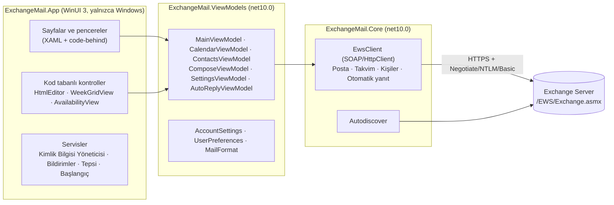

<p align="center">
  
</p>

<h1 align="center">Postacı</h1>

<p align="center">
  Şirket içi (on-premises) Exchange Server için modern bir Windows posta, takvim ve kişiler istemcisi.<br>
  WinUI 3 · .NET 10 · Exchange Web Services
</p>

<p align="center">
  <a href="https://github.com/ordaolmayanadam/postaci/actions/workflows/ci.yml"></a>
  <a href="LICENSE"></a>
  <a href="#yapay-zekâ-ile-geliştirme"></a>
  <a href="CONTRIBUTING.md"></a>
  <a href="https://github.com/ordaolmayanadam/postaci/releases/latest"></a>
</p>

<p align="center">
  <b>Türkçe</b> · <a href="README.en.md">English</a>
</p>

---

Postacı, kurum içinde barındırılan **Exchange Server 2016, 2019 ve Subscription Edition** posta kutularına
**Exchange Web Services (EWS)** üzerinden bağlanır. Kurulum gerektirmez, yönetici yetkisi istemez ve
yapılandırılan Exchange sunucusu dışında hiçbir yere veri göndermez.

> [!NOTE]
> **Yapay zekâ ile geliştirilmiş, kişisel ve açık kaynaklı bir proje.**
> Postacı bir şirket ürünü değildir; bağımsız bir kişisel projedir ve herkesin geliştirmesine açıktır.
> Kodun, testlerin, belgelerin ve simgenin büyük bölümü Anthropic'in yapay zekâ asistanı **Claude** (Claude Code)
> ile, proje sahibinin yönlendirmesi ve gözden geçirmesiyle yazıldı. Neyin doğrulandığını ve neyin henüz
> doğrulanmadığını [Yapay zekâ ile geliştirme](#yapay-zekâ-ile-geliştirme) bölümünde bulabilirsiniz.

## İçindekiler

- [Öne çıkanlar](#öne-çıkanlar)
- [Kurulum](#kurulum)
- [İlk bağlantı](#ilk-bağlantı)
- [Özellikler](#özellikler)
- [Klavye kısayolları](#klavye-kısayolları)
- [Sorun giderme](#sorun-giderme)
- [Kaynak koddan derleme](#kaynak-koddan-derleme)
- [Sürekli entegrasyon ve sürüm yayınlama](#sürekli-entegrasyon-ve-sürüm-yayınlama)
- [Mimari](#mimari)
- [Veriler, gizlilik ve güvenlik](#veriler-gizlilik-ve-güvenlik)
- [Bilinen sınırlamalar ve yol haritası](#bilinen-sınırlamalar-ve-yol-haritası)
- [Yapay zekâ ile geliştirme](#yapay-zekâ-ile-geliştirme)
- [Katkıda bulunma](#katkıda-bulunma)
- [Lisans](#lisans)

## Öne çıkanlar

- **Posta:** anında yeni posta, konuşma görünümü, çoklu seçim ve klasöre sürükle-bırak, sunucu taraflı arama, biçimli
  yazma, taslak düzenleme, ekler, toplantı davetlerine yanıt.
- **Takvim:** Outlook tarzı saat ızgarası, sürükle-bırak ile taşıma, toplantı oluşturma ve katılımcı uygunluğu.
- **Kişiler:** kişisel kişiler ve şirket rehberi (genel adres listesi).
- **Masaüstüne uyum:** Windows bildirimleri, sistem tepsisi, görev çubuğu rozeti, Windows açılışında başlatma.
- **Güvenli okuma:** iletilerde betikler kapalı, uzak resimler varsayılan olarak engelli.
- **Tek oturum açma:** etki alanındaki bilgisayarlarda Windows oturumuyla parolasız bağlantı (Kerberos/NTLM).
- **Türkçe ve İngilizce arayüz:** varsayılan olarak Windows dilini izler; Ayarlar → Görünüm → Dil'den değiştirilebilir.
  Tarih ve saat biçimleri de seçilen dile uyar.

## Kurulum

### Microsoft Store

Postacı Microsoft Store üzerinden dağıtılır: Store'da **Postacı**'yı arayıp **Yükle**'ye basın. Güncellemeler
Store'dan kendiliğinden gelir. Store gereken Windows App Runtime'ı da kurar, .NET ise paketin içindedir. Ayrıca
gereken tek bileşen Windows 11'de hazır gelen **Microsoft Edge WebView2 Runtime**'dır; Windows 10'da eksikse
[Microsoft'un sayfasından](https://developer.microsoft.com/microsoft-edge/webview2/) kurulabilir.

> Store kaydı yayımlanınca bağlantısı buraya eklenecek. O zamana kadar uygulama
> [kaynak koddan](#kaynak-koddan-derleme) çalıştırılabilir.

**Zip sürümünden (0.4 ve öncesi) geçiş:** Store sürümünü ilk açtığınızda hesap ve tercihler zip sürümünün
`%LOCALAPPDATA%\Postaci` klasöründen kendiliğinden taşınır; kayıtlı parola da kullanılmaya devam eder. Ardından:

1. Zip sürümünde **Windows açılışında başlat** açıksa, o sürümü bir kez açıp bu ayarı kapatın (yoksa Windows
   açılışında eski sürüm de başlar).
2. Zip klasörünü ve `%LOCALAPPDATA%\Postaci` klasörünü silin.

### Sistem gereksinimleri

| | En az |
|---|---|
| İşletim sistemi | Windows 10 sürüm 1809 (17763) veya Windows 11 |
| Mimari | x64 veya ARM64 |
| Exchange | Exchange Server 2016, 2019 veya Subscription Edition; EWS açık |

### Kaldırma

1. Uygulamayı kapatın (tepsi simgesi → **Çıkış**).
2. **Windows Ayarlar → Uygulamalar → Yüklü uygulamalar → Postacı → Kaldır**. Ayarlar, tercihler ve WebView2 profili
   uygulamayla birlikte silinir.
3. İsterseniz kayıtlı parolayı silin: **Denetim Masası → Kimlik Bilgisi Yöneticisi → Windows Kimlik Bilgileri →**
   `Postaci:<kullanıcı>`. Ayarlar'daki **Oturumu kapat** düğmesi de bunu yapar.

## İlk bağlantı

İlk açılışta bağlantı ekranı gelir:

| Alan | Açıklama |
|---|---|
| **E-posta adresi** | Posta kutunuzun adresi. Autodiscover bu adresin alan adından yola çıkar. |
| **Kimlik doğrulama** | *Windows oturumumu kullan*: etki alanındaki bilgisayarlarda parola gerekmez. Kapalıysa kullanıcı adı ve parola istenir. |
| **Kullanıcı adı** | `ŞİRKET\kullanici` ya da `kullanici@sirket.com.tr`. Boş bırakılırsa e-posta adresi kullanılır. |
| **Parolayı sakla** | Parola Windows Kimlik Bilgisi Yöneticisi'nde saklanır; sonraki açılışlarda otomatik bağlanılır. |
| **Gelişmiş → EWS adresi** | Autodiscover çalışmazsa elle girin: `https://mail.sirket.com.tr/EWS/Exchange.asmx` |

Bağlandıktan sonra pencereyi kapatmak oturumu kapatmaz: uygulama sistem tepsisine küçülür ve yeni postaları
denetlemeye devam eder. Tamamen kapatmak için tepsi simgesine sağ tıklayıp **Çıkış**'ı seçin.

### Exchange tarafında gerekenler

- EWS sanal dizini erişilebilir olmalı: `https://<sunucu>/EWS/Exchange.asmx`
- EWS kullanıcı ve kuruluş için açık olmalı:
  ```powershell
  Get-CASMailbox <kullanıcı> | Format-List EwsEnabled
  Get-OrganizationConfig | Format-List EwsEnabled
  ```
- Sunucu sertifikası istemcide güvenilir olmalı. Etki alanındaki bilgisayarlar kurum sertifika yetkilisine
  genellikle zaten güvenir. Postacı sertifika hatalarını **yok saymaz**.

## Özellikler

### Posta

- Bütün posta klasörleri hiyerarşik ve okunmamış sayılarıyla listelenir; gizli sistem klasörleri gösterilmez.
- İleti listesi 50'şer öğe yüklenir. Okunmamış, ek, yüksek önem ve toplantı işaretleri görünür; Gönderilmiş Öğeler'de alıcı gösterilir.
- **Arama** sunucu tarafında yapılır ve AQS sözdizimini destekler: `from:ali rapor`, `hasattachment:yes`, `subject:bütçe`.
- **Anında yeni posta:** Exchange değişiklikleri bir bildirim aboneliğiyle (EWS streaming) anında bildirir; yeni iletiler
  saniyeler içinde listenin başına eklenir, başka istemcilerde (Outlook, OWA, telefon) değişen okundu durumu eşitlenir.
  Bağlantı koparsa Postacı kendiliğinden yeniden bağlanır; bu arada ayarlardaki aralıkla (varsayılan dakikada bir)
  yoklamaya devam eder.
- **Konuşma görünümü:** liste başlığındaki düğmeyle iletiler konuşmalara göre gruplanır; her satırda en son iletinin
  önizlemesi ve konuşmadaki ileti sayısı görünür. Birden fazla iletili konuşmanın solundaki ok (veya → / ← tuşları)
  konuşmanın iletilerini altında girintili olarak açar ve kapatır; her biri tek başına açılabilir. Bir konuşma seçilince bütün
  iletileri (Gönderilmiş Öğeler'deki yanıtlarınız dahil) okuma bölmesinde yeniden eskiye alt alta, alıntılar
  tekrarlanmadan görünür. Yanıtla, konuşmadaki başkasından gelen en son iletiye yanıt verir.
- **Çoklu seçim:** Ctrl/Shift ile tıklayarak veya Ctrl+A ile birden fazla ileti seçilir; sil, taşı ve okundu/okunmadı
  hepsine birden uygulanır. İletiler **sürüklenip bir klasörün üzerine bırakılarak** taşınabilir.
- Seçilen ileti **okundu** sayılır; Ayarlar'dan "birkaç saniye sonra" veya "hiçbir zaman" seçilebilir.
  Okundu bilgisi istenmiş iletiler için bildirim sessizce gönderilmez.
- Yanıtla, tümünü yanıtla, ilet, sil (Silinmiş Öğeler'de onayla kalıcı silme), klasöre taşı, okundu/okunmadı.
- **Toplantı davetleri** okuma bölmesinden kabul edilir, "belki" yanıtı verilir veya reddedilir.
- **Kişi kartı:** okuma bölmesinde gönderenin veya Kime/Bilgi'deki bir adın üzerine tıklayınca şirket rehberindeki
  bilgileri (fotoğraf, unvan, departman, ofis, telefonlar), yönetici zinciri en üstten aşağıya ve doğrudan bağlı
  çalışanlar görünür. Zincirdeki bir ada tıklamak o kişinin kartını açar.
- **Ekler** kaydedilir; ekli e-postalar `.eml` olarak indirilir. Gövdedeki gömülü resimler gösterilir.

### Yazma

- **Biçimli metin:** kalın, italik, altı çizili, yazı rengi ve boyutu, madde işaretli ve numaralı liste, bağlantı.
- Kime, Bilgi ve Gizli alanlarında **şirket rehberinden otomatik tamamlama**.
- Dosya seçerek veya **sürükle-bırak** ile ek ekleme.
- **Taslaklar:** aynı penceredeki her kayıt aynı taslağı günceller. Taslaklar klasöründeki ileti
  *Taslağı düzenle* (veya çift tıklama) ile açılır, düzenlenir ve gönderilir; taslaktaki ekler kaldırılabilir.
- **Yanıt ve iletmede özgün ileti düzenleyicide görünür:** pencere açılınca taslak oluşturulur, Exchange alıntıyı (iletmede
  ekleri de) ekler ve düzenleyiciye gömülü resimleriyle yüklenir; alıntı da düzenlenebilir. Gönderilmeden kapatılan
  pencerenin otomatik taslağı silinir; "Taslak kaydet" ile kaydedilen taslak kalır.
- **Biçimli imza** yeni iletilere, yanıtlara ve iletmelere otomatik eklenir.
- Kaydedilmemiş değişiklik varken pencere kapatılırsa uyarı gösterilir.

### Takvim

- Ay takviminden gün seçilir. **Gün ve hafta görünümü saat ızgarasıdır** (çakışan etkinlikler yan yana); ay görünümü ajanda listesidir.
- Etkinlikler **sürükle-bırak** ile taşınır (15 dakikalık adımlarla, günler arasında). Boş bir saate çift tıklamak o saatte yeni etkinlik açar.
- **Yeni etkinlik veya toplantı:** konu, konum, tüm gün, başlangıç/bitiş, katılımcılar, anımsatıcı, durum (boş/belki/meşgul/dışarıda).
- **Uygunluk:** toplantı oluştururken sizin ve katılımcıların meşgul saatleri zaman çizelgesinde görünür.
- Kendi etkinlikleriniz ve düzenleyeni olduğunuz toplantılar **düzenlenir**; değişiklik katılımcılara bildirilir.
- Davetler kabul edilir, "belki" yanıtı verilir veya reddedilir; düzenlediğiniz toplantı iptal edilince katılımcılara bildirim gider.

### Kişiler

- **Kişilerim** (Kişiler klasörü) ve **Şirket rehberi** (genel adres listesi) arasında geçiş ve arama.
- Ayrıntı: e-posta, iş ve cep telefonu, unvan, departman, şirket. Tek tıkla e-posta yazma.
- Kişi ekleme, düzenleme, silme; rehberdeki birini kişilerinize kopyalama.

### Masaüstü

- **Bildirimler:** gelen kutusuna yeni ileti düştüğünde Windows bildirimi; tıklayınca ileti açılır.
- **Görev çubuğu rozeti** ve **sistem tepsisi** simgesinde okunmamış sayısı. Tepsi menüsü: Aç, Yeni posta, Yeni postaları denetle, Çıkış.
- **Windows açılışında başlatma** (isteğe bağlı): tepside başlar, kayıtlı hesapla bağlanır. Yönetici yetkisi gerekmez.
- **Otomatik yanıtlar (ofis dışında):** tarih aralığı, kuruluş içi ve dışı için ayrı metin. Açıkken üstte uyarı şeridi görünür.

### Ayarlar

| Bölüm | Seçenekler |
|---|---|
| Posta | Okundu işaretleme zamanı, yeni posta denetim aralığı, uzak resimleri her zaman gösterme, imza, bildirimler |
| Otomatik yanıtlar | Açık/kapalı, zaman aralığı, iç ve dış yanıt metinleri, dış alıcı kapsamı |
| Uygulama | Kapatınca tepsiye küçült, Windows açılışında başlat |
| Görünüm | Tema (Windows / açık / koyu; koyu tema yumuşak lacivert-gri tonlu), dil (Windows / Türkçe / English; yeniden başlatınca uygulanır), klasör listesi (kompakt / rahat) |
| Yazı tipleri | Arayüz yazı tipi ve boyutu (yeniden başlatınca uygulanır), okuma yazı tipi ve yakınlaştırma, yazma yazı tipi ve boyutu |
| Hesap | E-posta, sunucu, oturum açma yöntemi; kayıtlı parolayı silme, oturumu kapatma |

## Klavye kısayolları

| Kısayol | İşlem |
|---|---|
| `Ctrl+1` / `Ctrl+2` / `Ctrl+3` | Posta / Takvim / Kişiler |
| `Ctrl+N` | Yeni posta (Takvim'de yeni etkinlik, Kişiler'de yeni kişi) |
| `Ctrl+R` / `Ctrl+Shift+R` | Yanıtla / Tümünü yanıtla |
| `Ctrl+F` | İlet |
| `Del` | Sil (ileti listesindeyken) |
| `Ctrl+Q` | Okundu / okunmadı (seçili iletilerin hepsi) |
| `Ctrl+A` | İleti listesinde hepsini seç |
| `Ctrl+E` | Ara |
| `F5` | Yenile |
| `F9` | Gönder/Al: yeni postaları hemen denetle |
| `Ctrl+Enter` / `Ctrl+S` | Gönder / Taslak kaydet (yazma penceresinde) |
| `Ctrl+B` / `Ctrl+I` / `Ctrl+U` | Kalın / İtalik / Altı çizili (yazma penceresinde) |
| `Ctrl` + fare tekerleği | Okuma bölmesinde yakınlaştırma |

## Sorun giderme

| Belirti | Olası neden ve çözüm |
|---|---|
| "Autodiscover EWS adresini bulamadı" | Autodiscover DNS kaydı yok veya dışarıya kapalı. **Gelişmiş → EWS adresi** alanına adresi elle girin. |
| "Kimlik doğrulama başarısız" | Kullanıcı adı biçimini deneyin (`ŞİRKET\kullanici` ↔ UPN). Windows oturumu seçiliyse bilgisayarın etki alanında olduğundan emin olun. |
| "Sunucuya ulaşılamadı" / sertifika hatası | Sunucu sertifikası bu bilgisayarda güvenilir değil veya ağ erişimi yok. Tarayıcıda EWS adresini açıp sertifikayı kontrol edin. |
| `ErrorServerBusy` | Exchange istek sınırına (throttling) ulaşıldı. Postacı otomatik olarak bekleyip yeniden dener; sürerse denetim aralığını uzatın. |
| İleti gövdesi boş / "WebView2 başlatılamadı" | WebView2 Runtime eksik. [Microsoft'tan](https://developer.microsoft.com/microsoft-edge/webview2/) kurun. |
| Bildirim çıkmıyor | Windows Ayarlar → Bildirimler'de Postacı'nın açık olduğunu ve "Rahatsız etmeyin"in kapalı olduğunu kontrol edin. Postacı Ayarlar'ında bildirimler açık olmalı. |
| Her açılışta parola soruluyor | Bağlanırken "Parolayı sakla" işaretli olmalı. Kimlik Bilgisi Yöneticisi'nde `Postaci:<kullanıcı>` kaydının oluştuğunu kontrol edin. |
| Uygulama kapanıyor veya bir şey sessizce çalışmıyor | **Ayarlar → Hakkında → Tanılama günlüğünü aç**: hatalar ve çökmeler `%LOCALAPPDATA%\Packages\<Postacı paketi>\LocalState\postaci.log` dosyasına yazılır (ileti içeriği yazılmaz). Hata bildirirken ilgili satırları, sunucu ve adres bilgilerini gizleyerek ekleyin. |
| Takvim saatleri kayık | Windows saat dilimi ayarını kontrol edin; Postacı takvim isteklerinde Windows saat dilimini Exchange'e bildirir. |

Hata bildirirken lütfen [hata şablonunu](.github/ISSUE_TEMPLATE/bug_report.yml) kullanın ve **gerçek posta içeriği,
adres veya sunucu adı paylaşmayın**.

## Kaynak koddan derleme

### Gereksinimler

- **Uygulamanın tamamı için:** Windows 10/11, [.NET 10 SDK](https://dotnet.microsoft.com/download/dotnet/10.0).
  İsteğe bağlı olarak Visual Studio 2026 (veya 2022 17.14+) ve **WinUI application development** iş yükü.
- **Yalnızca kütüphaneler ve testler için:** .NET 10 SDK yeterlidir; Linux ve macOS'ta da çalışır.

### Komutlar

```powershell
# Uygulamayı derleme
dotnet build src\ExchangeMail.App -c Debug -p:Platform=x64

# Store'a yüklenecek paket (imzasız; Store imzalar)
dotnet build src\ExchangeMail.App -c Release -r win-x64 -p:Platform=x64 -p:GenerateAppxPackageOnBuild=true -p:UapAppxPackageBuildMode=StoreUpload -p:AppxBundle=Never

# Testler (her işletim sisteminde)
dotnet test --project tests\ExchangeMail.Core.Tests
```

Uygulama paketli (MSIX) çalışır: bildirimler, Windows açılışında başlatma ve veri klasörü paket kimliğine bağlıdır,
bu yüzden `Postaci.exe` doğrudan çalıştırılmaz. Çalıştırmak için Visual Studio'da `ExchangeMail.slnx` dosyasını açın,
**ExchangeMail.App**'i başlangıç projesi yapın, platformu **x64** seçip F5'e basın. Visual Studio paketi imzasız
olarak kaydedip başlatır; bunun için Windows'ta **Geliştirici Modu** açık olmalıdır
(Ayarlar → Sistem → Geliştiriciler için).

> Çözümün tamamını (`dotnet test` köke çalıştırarak) Linux/macOS'ta derlemeye çalışmayın: WinUI projesinin XAML
> derleyicisi yalnızca Windows'ta çalışır. Test projesini `--project` ile çalıştırın.

## Sürekli entegrasyon ve sürüm yayınlama

| İş akışı | Ne zaman | Ne yapar |
|---|---|---|
| [`ci.yml`](.github/workflows/ci.yml) | `main`'e her push, her pull request, elle | Testleri Ubuntu ve Windows'ta çalıştırır; ardından uygulamayı x64 ve ARM64 için MSIX olarak paketler, paketin içeriğini denetler ve imzasız paketleri 14 gün artifact olarak saklar |
| [`release.yml`](.github/workflows/release.yml) | `v1.2.3` biçiminde etiket push edildiğinde | Testleri çalıştırır, etiketteki sürüm numarasıyla x64 ve ARM64 Store paketlerini (`.msixupload`) üretip `store-win-x64` / `store-win-arm64` artifact'leri olarak saklar ve GitHub sürümünü oluşturur |
| [`dependabot.yml`](.github/dependabot.yml) | Haftalık | NuGet paketleri ve GitHub Actions için güncelleme PR'ları açar |

**İlk kez (bir kerelik):**

1. [Partner Center](https://partner.microsoft.com/dashboard)'da geliştirici hesabı açın (bireysel hesap ücretsizdir)
   ve **Uygulamalar ve oyunlar → Yeni ürün → MSIX veya PWA uygulaması** ile `Postacı` adını ayırın.
2. **Ürün yönetimi → Ürün kimliği** sayfasındaki `Package/Identity/Name`, `Package/Identity/Publisher` ve
   `Package/Properties/PublisherDisplayName` değerlerini
   [`Package.appxmanifest`](src/ExchangeMail.App/Package.appxmanifest)'e yazıp commit edin. Yer tutucu değerler
   duruyorsa sürüm iş akışı hata verir.

**Her sürümde:**

```bash
git tag v1.0.0
git push origin v1.0.0
```

1. İş akışı bitince çalışmanın sayfasından `store-win-x64` ve `store-win-arm64` artifact'lerini indirip açın.
2. Partner Center'da yeni bir gönderim başlatın, **Paketler** bölümüne iki `.msixupload` dosyasını yükleyin ve
   gönderin. Store paketi imzalar, onaydan sonra yayımlar.

Etiket `-` içeriyorsa (ör. `v1.1.0-beta.1`) GitHub sürümü "ön sürüm" olarak işaretlenir; paketin sürüm numarası
yalnızca sayısal kısımdan (`1.1.0.0`) oluşur. Sürüm notları, önceki etiketten bu yana birleştirilen PR'lardan
otomatik oluşturulur.

## Mimari



| Proje | Hedef | Sorumluluk |
|---|---|---|
| `src/ExchangeMail.Core` | `net10.0` | EWS istemcisi (ham SOAP, `HttpClient`), Autodiscover, modeller, Türkçe/İngilizce metin kaynakları. Arayüzden habersiz. |
| `src/ExchangeMail.ViewModels` | `net10.0` | MVVM katmanı ([CommunityToolkit.Mvvm](https://learn.microsoft.com/dotnet/communitytoolkit/mvvm/)), tercihler, HTML yardımcıları. WinUI'ye bağımlı değil. |
| `src/ExchangeMail.App` | `net10.0-windows` | WinUI 3 arayüzü, WebView2, Windows servisleri. Tek projeli MSIX paketi (Microsoft Store); Windows App Runtime çerçeve bağımlılığı, .NET pakete dahil. |
| `tests/ExchangeMail.Core.Tests` | `net10.0` | Sahte EWS sunucusuna (`FakeEwsServer`) karşı birim testleri (xUnit v3). Gönderilen SOAP isteklerinin yapısını ve sırasını da doğrular. |

İş mantığının tamamı Windows'a bağımlı olmayan iki kütüphanede durduğu için CI'da Linux'ta derlenip test edilir.
EWS Managed API kullanılmaz; Microsoft o kütüphaneyi artık geliştirmiyor.

### Önemli akışlar

**Gönderme.** Eki olmayan yeni ileti tek bir `CreateItem(SendAndSaveCopy)` ile gider. Yanıt, iletme, ekli ileti
veya var olan taslak şu sırayla gönderilir:

1. `GetItem`: özgün iletinin güncel `ChangeKey`'i alınır.
2. `CreateItem(SaveOnly)` + `ReplyToItem` / `ReplyAllToItem` / `ForwardItem`: Exchange alıntıyı ekleyerek taslağı oluşturur.
   Yanıt ve iletmede bu adım yazma penceresi açılırken yapılır; taslağın gövdesi (`GetItem`, gömülü resimler için
   `GetAttachment`) düzenleyiciye yüklenir. Resimler düzenleyicide `data:` adresi olur, kaydederken yeniden `cid:`
   başvurusuna çevrilir; özgün iletinin `<head>` stilleri korunur.
3. `UpdateItem`: kullanıcının düzenlediği alıcılar, konu, önem ve (taslak varsa) gövde yazılır.
4. `CreateAttachment` / `DeleteAttachment`: ekler eklenir veya kaldırılır.
5. `SendItem`: taslak gönderilir ve Gönderilmiş Öğeler'e kaydedilir.

**Yeni posta.** Oturum açılınca bütün klasörlere bir EWS streaming aboneliği (`Subscribe` + `GetStreamingEvents`)
açılır; sunucu bağlantıyı açık tutup her değişikliği anında gönderir. Posta klasörlerini ilgilendiren bir değişiklik
gelince klasör sayıları ve görünen liste hemen yenilenir. Bağlantı 10 dakikada bir yenilenir; abonelik düşerse yeniden
kurulur, sunucuya ulaşılamazsa 15 saniyeden 5 dakikaya kadar artan aralıklarla denenir. Yedek olarak ayarlardaki
aralıkla yoklama sürer; daha önce görülmemiş okunmamış iletiler için bildirim gösterilir. İstekler, çok sunuculu
kurulumlarda doğru posta kutusu sunucusuna gitmesi için `X-AnchorMailbox` başlığı taşır.

**Konuşmalar.** Konuşma görünümünde liste `FindConversation` ile, seçilen konuşmanın iletileri `GetConversationItems`
ile (Silinmiş Öğeler ve Taslaklar hariç) alınır. Her iletinin yalnızca kendi eklediği metin (`UniqueBody`) gösterilir.
Arama sonuçları ve Taslaklar / Giden Kutusu her zaman tek tek ileti olarak listelenir.

**Takvim.** Takvim isteklerine Windows saat dilimi (`TimeZoneContext`) eklenir. Böylece tüm gün etkinlikleri ve
görünümler yerel saate göre hesaplanır. Yinelenen toplantılar `CalendarView` ile tek tek tekrarlara açılır.

**Sunucu yükü.** Exchange `ErrorServerBusy` döndürdüğünde istemci, sunucunun bildirdiği süre kadar (en fazla 30 sn)
bekleyip iki kez yeniden dener.

## Veriler, gizlilik ve güvenlik

| Ne | Nerede |
|---|---|
| Hesap ayarları (e-posta, kullanıcı adı, EWS adresi) | Uygulama veri klasörü (`%LOCALAPPDATA%\Packages\<Postacı paketi>\LocalState`): `settings.json` |
| Tercihler | Uygulama veri klasörü: `preferences.json` |
| Parola | Windows Kimlik Bilgisi Yöneticisi → Genel: `Postaci:<kullanıcı>` |
| WebView2 profili | Uygulama veri klasörü: `WebView2` |
| Okuma bölmesi geçici dosyaları | `%TEMP%\Postaci` (her açılışta temizlenir) |
| Windows açılışında başlatma | Paketin başlangıç görevi (Windows Ayarlar → Uygulamalar → Başlangıç'ta da görünür) |

- Parola düz metin olarak diske yazılmaz; yalnızca Kimlik Bilgisi Yöneticisi'nde (DPAPI ile korunur) tutulur.
- İleti gövdesi, betikleri ve (izin verilmedikçe) uzak kaynakları engelleyen bir **Content-Security-Policy** ile
  gösterilir; WebView2'de betikler kapalıdır ve Exchange'in `FilterHtmlContent` süzgeci açıktır. Bağlantılar varsayılan tarayıcıda açılır.
- TLS sertifika doğrulaması devre dışı bırakılmaz.
- **Telemetri yoktur.** Uygulamanın tek ağ trafiği yapılandırılan Exchange sunucusunadır.

Güvenlik açığı bildirimi için [SECURITY.md](SECURITY.md) dosyasına bakın.

## Bilinen sınırlamalar ve yol haritası

- Görevler (Tasks) yok.
- Yinelenen bir toplantının tüm serisini düzenleme yok; ızgarada yapılan değişiklik yalnızca o tekrarı etkiler.
- Etkinlik süresi ızgarada kenarından çekilerek değiştirilemez; süre düzenleme penceresinden değişir.
- Konuşma görünümünde yalnızca en son iletinin gömülü resimleri yüklenir; eski iletilerdeki resimler için iletiyi tek başına açın.
- Yazma penceresinde resim yapıştırma/ekleme ve tablo düzenleme yok.
- Hybrid Modern Authentication (OAuth) yok; yalnızca Negotiate (Kerberos/NTLM) ve Basic.
- S/MIME şifreleme/imza, paylaşılan posta kutuları ve arşiv posta kutusu yok.
- Arayüz yazı tipi değişikliği yeniden başlatma gerektirir; bazı yerleşik WinUI parçaları kendi boyutunu koruyabilir.

Öneriler için [özellik isteği](.github/ISSUE_TEMPLATE/feature_request.yml) açabilirsiniz.

## Yapay zekâ ile geliştirme

Postacı, bir kişinin yapay zekâ asistanıyla birlikte geliştirdiği bir projedir ve bunu açıkça belirtmek istiyoruz:

- **Nasıl yazıldı?** Özellikler proje sahibi tarafından tarif edildi, hatalar kullanıcı gözüyle bildirildi; kod,
  testler, CI iş akışları, belgeler ve simge büyük ölçüde **Claude (Anthropic)** tarafından Claude Code ile üretildi.
  Yapay zekâ yardımıyla oluşturulan commit'ler `Co-Authored-By: Claude …` satırı taşır; geçmişte hangi değişikliğin
  bu şekilde yapıldığını `git log` ile görebilirsiniz.
- **Ne doğrulandı?** Exchange ile konuşan kodun tamamı ve ViewModel davranışları, sahte bir EWS sunucusuna karşı
  çalışan otomatik testlerle denetlenir. Testler ve uygulamanın Windows derlemesi her değişiklikte GitHub Actions'ta
  çalışır.
- **Ne henüz doğrulanmadı?** Özelliklerin hepsi gerçek bir Exchange sunucusunda ve farklı Windows sürümlerinde
  denenmedi; kod bağımsız bir güvenlik denetiminden geçmedi. Yapay zekânın ürettiği kod da insan yazımı kod gibi
  hata içerebilir.
- **Ne öneriyoruz?** Postacı'yı bir iş posta kutusuna bağlamadan önce kurumunuzun BT birimine danışın, önemli
  işlemlerden (silme, gönderme, otomatik yanıt) önce davranışı bir test hesabında deneyin ve bulduğunuz her hatayı
  [issue](../../issues) olarak bildirin.

Yapay zekâ araçlarıyla hazırlanmış katkılar da kabul edilir; kuralları
[CONTRIBUTING.md](CONTRIBUTING.md#yapay-zekâ-araçlarıyla-katkı) içindedir.

## Katkıda bulunma

Postacı herkesin geliştirmesine açıktır: ilk kez açık kaynağa katkı veriyor olun ya da deneyimli bir geliştirici
olun, hata bildirimleri, öneriler, belge düzeltmeleri, çeviriler, testler ve kod katkıları memnuniyetle karşılanır.
Gerçek bir Exchange sunucusunda deneyip sonucu paylaşmak bile çok değerlidir.

Geliştirme ortamı, katman kuralları, yeni bir EWS işleminin nasıl ekleneceği, test yazma ve PR süreci için
[CONTRIBUTING.md](CONTRIBUTING.md) dosyasını okuyun. Issue, PR ve commit mesajları Türkçe veya İngilizce
yazılabilir. Topluluk içinde birbirimize nasıl davrandığımız
[CODE_OF_CONDUCT.md](CODE_OF_CONDUCT.md) dosyasında yazılıdır.

## Lisans

Postacı [MIT Lisansı](LICENSE) ile dağıtılır: kodu ticari projeler dahil özgürce kullanabilir, değiştirebilir ve
dağıtabilirsiniz; tek koşul, telif ve lisans metnini kopyalarla birlikte korumaktır. Yazılım "olduğu gibi", hiçbir
garanti olmadan sunulur.

Kullanılan başlıca bileşenler de açık kaynak lisanslıdır: .NET ve Windows App SDK (MIT),
CommunityToolkit.Mvvm ve CommunityToolkit.WinUI.Controls (Sizers, SettingsControls; MIT), xUnit (Apache 2.0). Microsoft Edge WebView2 Runtime işletim sistemiyle gelir ve
uygulamayla birlikte dağıtılmaz.

Microsoft, Exchange, Outlook ve Windows, Microsoft Corporation'ın ticari markalarıdır. Postacı bağımsız bir
projedir; Microsoft ile bağlantılı değildir, Microsoft tarafından desteklenmez veya onaylanmaz.

Simge kaynakları ve yeniden üretme betikleri [`assets/icon/`](assets/icon/) altındadır.
